# ClinicQ – Health Centre Consultation Room Booking System

## 1. Project Overview

ClinicQ is a REST API-based consultation room booking system developed for a health centre. It helps manage doctors, consultation rooms, and patient consultation bookings.

The system allows users to add and view doctors, manage consultation rooms, create bookings, check booking details, and update booking statuses. It also prevents double booking of the same room at the same date and time.

## 2. Objectives

- To develop REST APIs using Node.js and Express.js.
- To manage doctor and consultation room details.
- To create and retrieve consultation bookings.
- To validate user inputs.
- To prevent duplicate room bookings.
- To manage booking status transitions.

## 3. Technologies Used

- Node.js
- Express.js
- SQLite
- SQLite3
- Postman
- Visual Studio Code
- JavaScript
- Git and GitHub

## 4. Project Folder Structure

```text
ClinicQ-BDF-Assignment/
│
├── routes/
│   ├── doctors.js
│   ├── rooms.js
│   └── bookings.js
│
├── screenshots/
│   ├── add-doctor.png
│   ├── get-all-doctors.png
│   ├── get-single-doctor.png
│   ├── doctor-validation.png
│   ├── add-room.png
│   ├── get-all-rooms.png
│   ├── get-single-room.png
│   ├── search-room-floor.png
│   ├── update-room.png
│   ├── delete-room.png
│   ├── re-add-room.png
│   ├── add-booking.png
│   ├── get-all-bookings.png
│   ├── get-single-booking.png
│   ├── booking-conflict.png
│   ├── approve-booking.png
│   ├── complete-booking.png
│   ├── invalid-booking-status.png
│   └── booking-validation.png
│
├── postman/
├── database.js
├── server.js
├── clinicq.db
├── package.json
├── package-lock.json
├── .gitignore
└── README.md
```

## 5. Database Design

The project uses an SQLite database named `clinicq.db`.

It contains three tables.

### 5.1 Doctors Table

Stores doctor information:

- id
- name
- specialization

### 5.2 Rooms Table

Stores consultation room information:

- id
- name
- floor

### 5.3 Bookings Table

Stores consultation booking information:

- id
- doctor_id
- room_id
- booking_date
- booking_time
- status

Foreign keys connect the bookings table with the doctors and rooms tables.

A unique index prevents multiple active bookings for the same room, date, and time.

## 6. API Endpoints

### 6.1 Doctors API

| HTTP Method | Endpoint | Description |
|---|---|---|
| GET | `/doctors` | Get all doctors |
| GET | `/doctors/:id` | Get doctor by ID |
| POST | `/doctors` | Add a new doctor |

### 6.2 Rooms API

| HTTP Method | Endpoint | Description |
|---|---|---|
| GET | `/rooms` | Get all rooms |
| GET | `/rooms?floor=1` | Search rooms by floor |
| GET | `/rooms/:id` | Get room by ID |
| POST | `/rooms` | Add a new room |
| PUT | `/rooms/:id` | Update room details |
| DELETE | `/rooms/:id` | Delete a room |

### 6.3 Bookings API

| HTTP Method | Endpoint | Description |
|---|---|---|
| GET | `/bookings` | Get all bookings |
| GET | `/bookings/:id` | Get booking by ID |
| POST | `/bookings` | Create a new booking |
| PUT | `/bookings/:id/status` | Update booking status |

## 7. Validation and Error Handling

The application includes input validation and appropriate HTTP status codes.

- **200 – OK:** Successful request.
- **201 – Created:** Resource created successfully.
- **400 – Bad Request:** Invalid input or validation error.
- **404 – Not Found:** Requested resource does not exist.
- **409 – Conflict:** Booking conflict or duplicate room booking.
- **500 – Internal Server Error:** Server-side error.

### Booking Conflict Prevention

The system prevents two active bookings for the same room, date, and time.

### Booking Status Management

Booking statuses follow this sequence:

**Pending → Approved → Done**

Invalid status transitions are rejected by the API.

## 8. Installation and Execution

### Step 1: Install Dependencies

Open the project folder in VS Code and run:

```bash
npm install
```

### Step 2: Start the Development Server

```bash
npm run dev
```

### Step 3: Open the API

```text
http://localhost:3000
```

### Step 4: Test the APIs

Open Postman and test the Doctors, Rooms, and Bookings endpoints.

## 9. API Testing and Screenshots

The REST APIs were tested using Postman. The following screenshots demonstrate the successful execution, validation, and testing of the project endpoints.

### 9.1 Doctors API Testing

**1. Add Doctor**

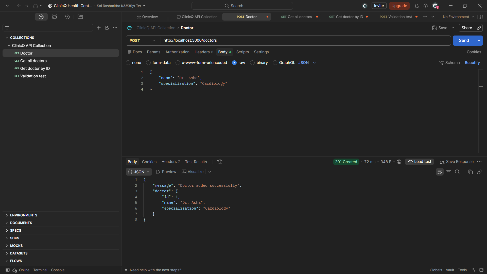

**2. Get All Doctors**

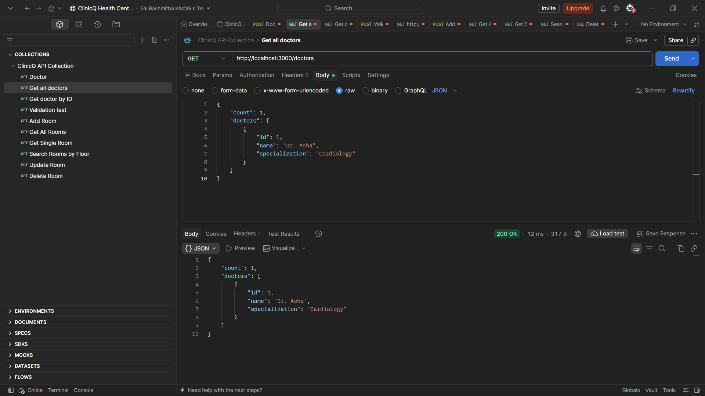

**3. Get Single Doctor**

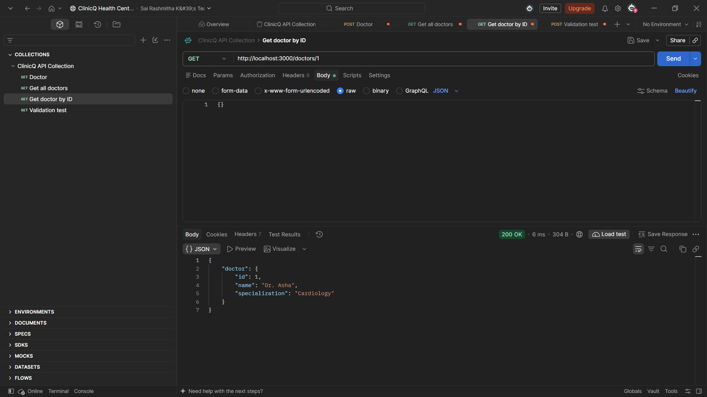

**4. Doctor Validation**

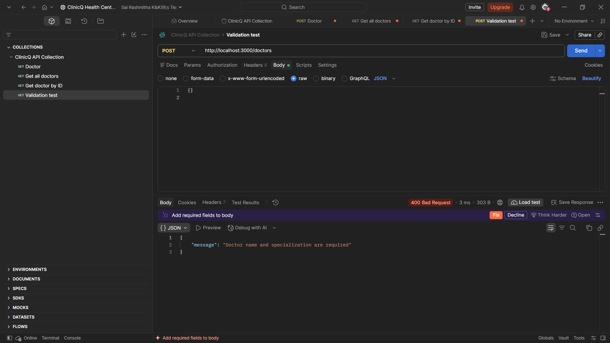

### 9.2 Rooms API Testing

**1. Add Room**

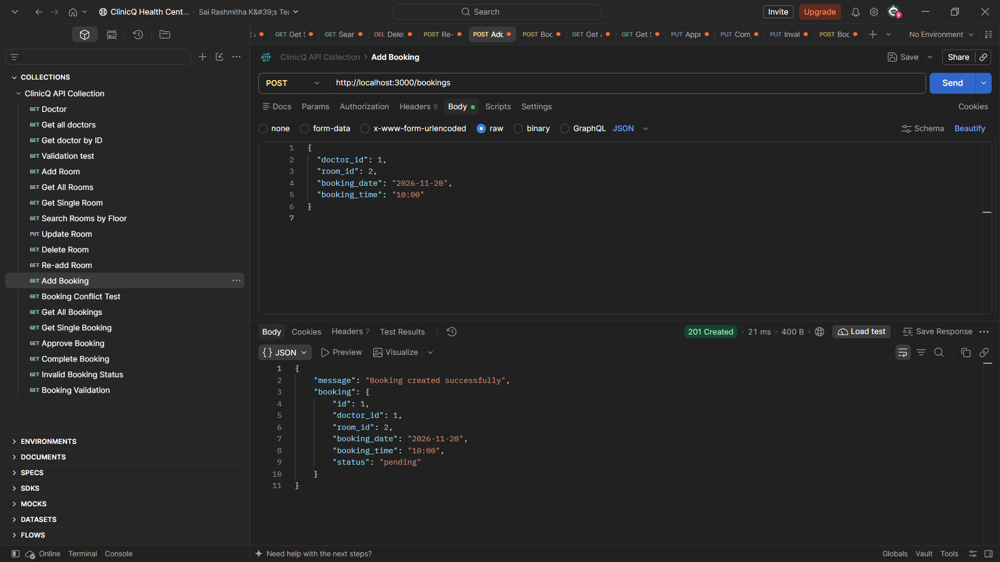

**2. Get All Rooms**

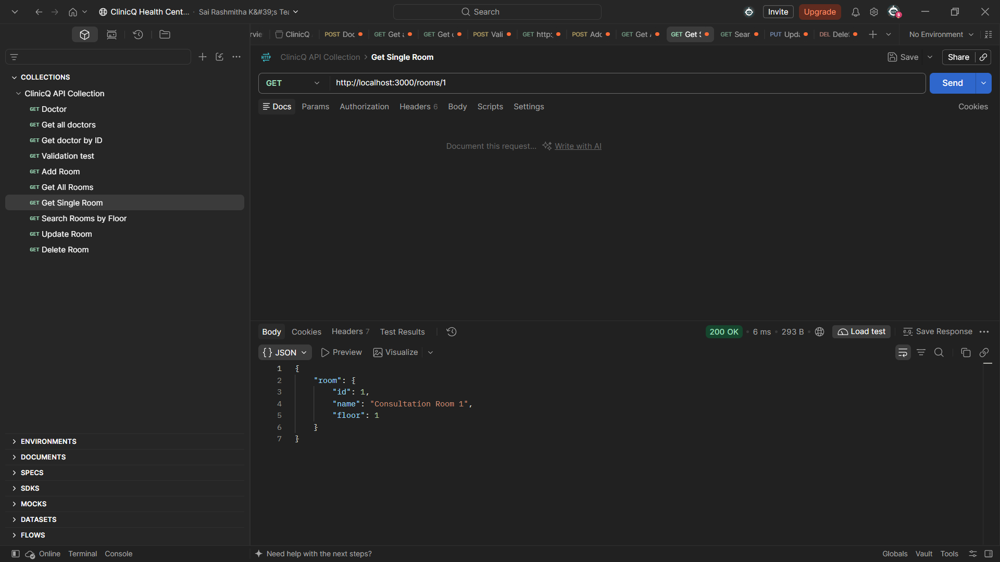

**3. Get Single Room**


**4. Search Rooms by Floor**

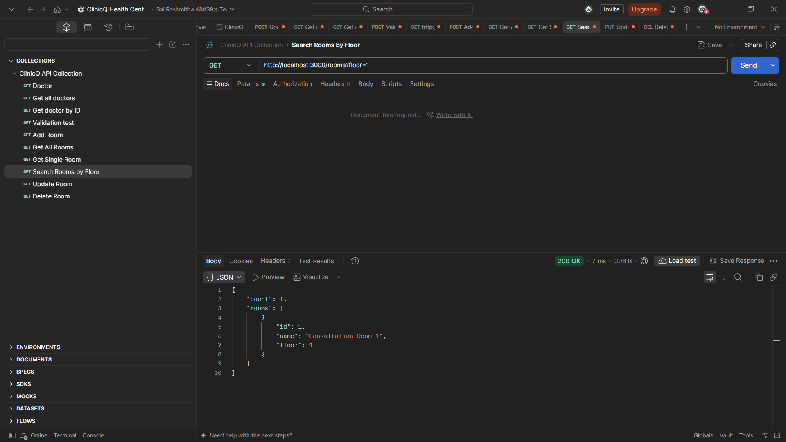

**5. Update Room**

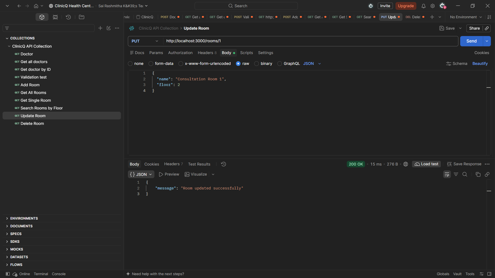

**6. Delete Room**

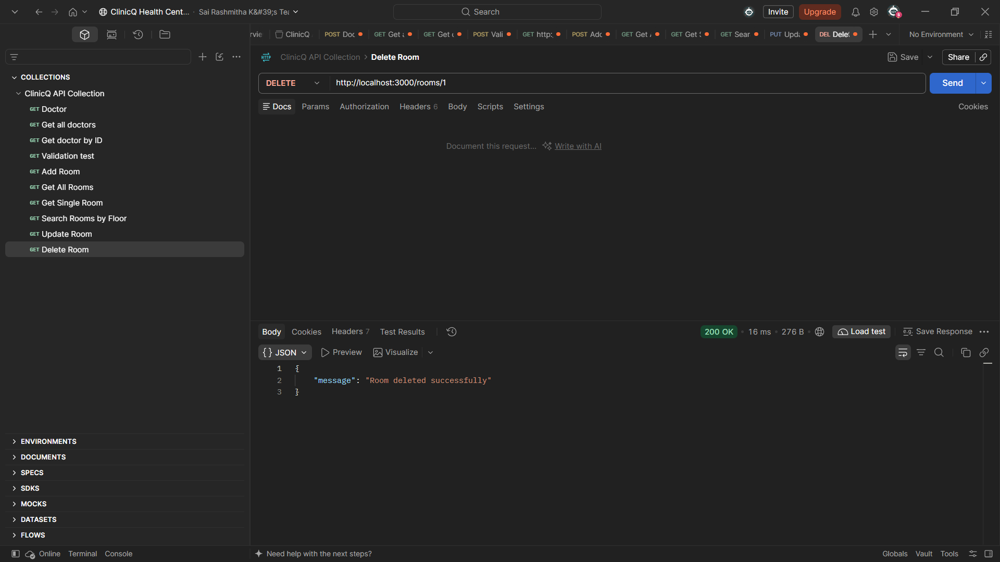

**7. Re-add Room**

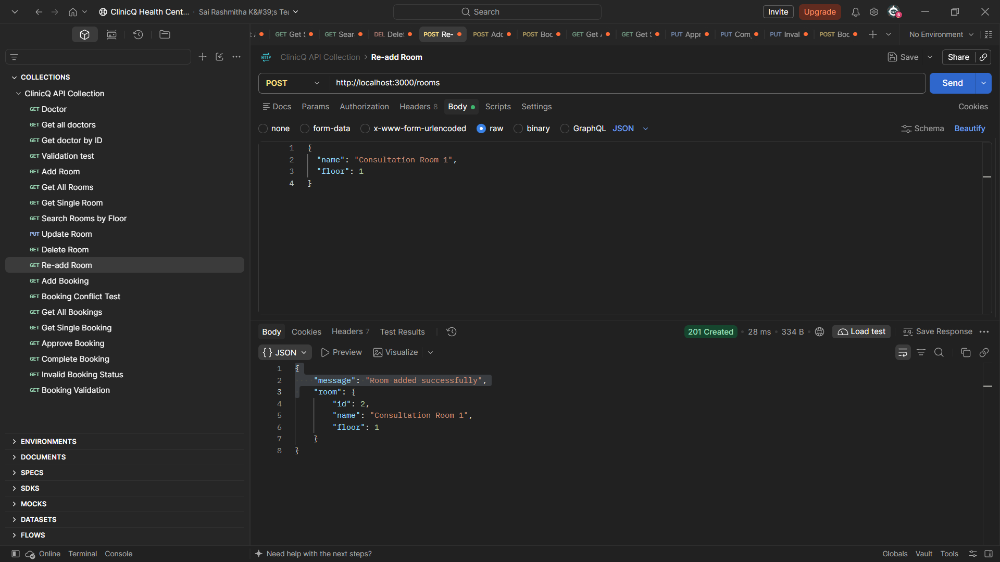

### 9.3 Bookings API Testing

**1. Add Booking**


**2. Get All Bookings**

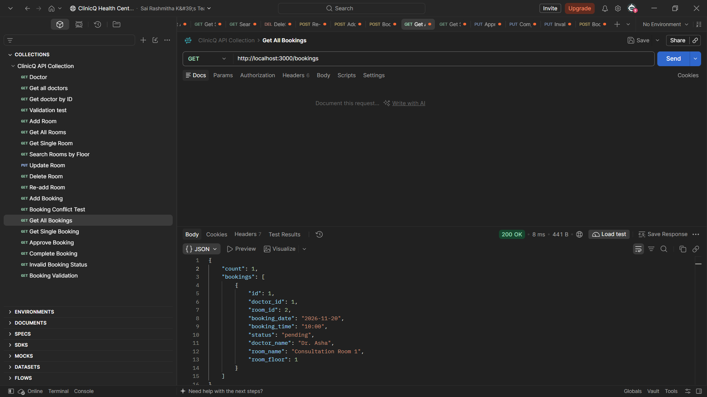

**3. Get Single Booking**

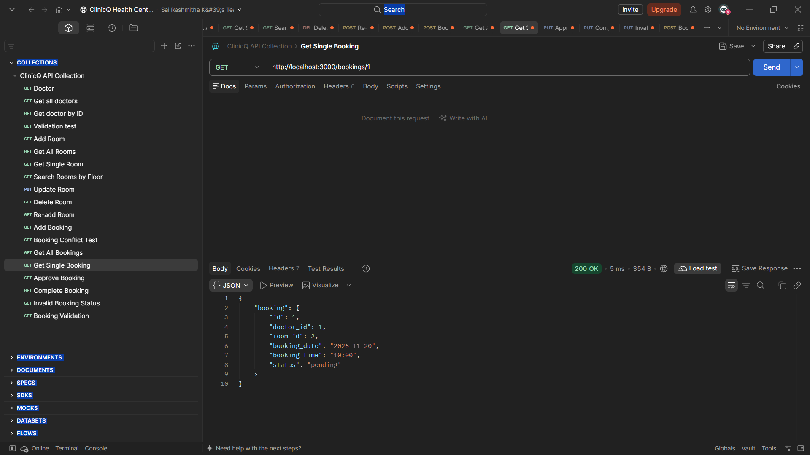

**4. Booking Conflict Validation**

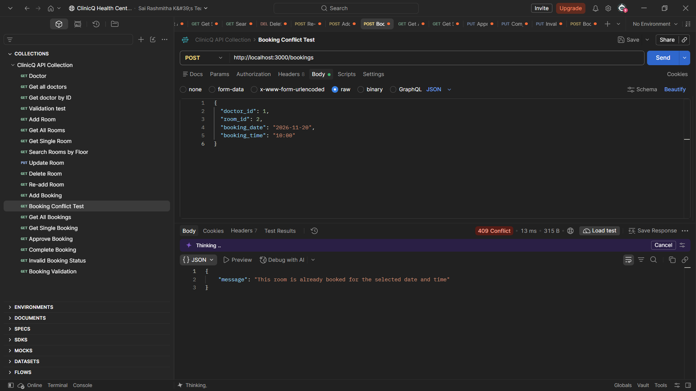

**5. Approve Booking**

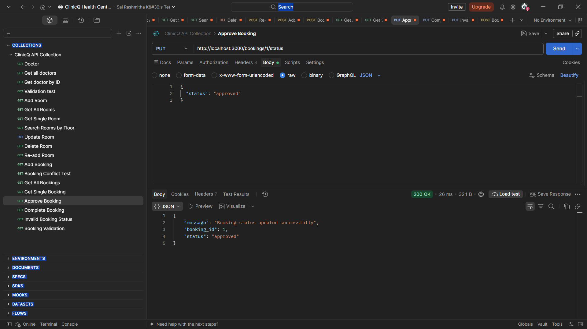

**6. Complete Booking**

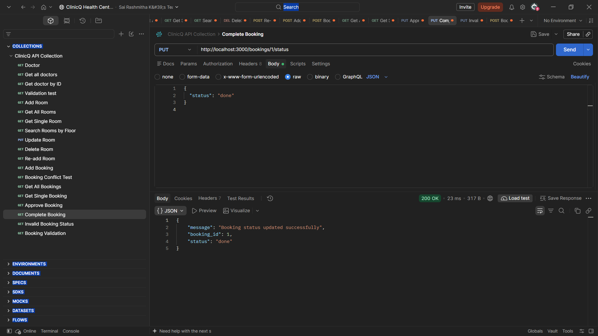

**7. Invalid Booking Status**

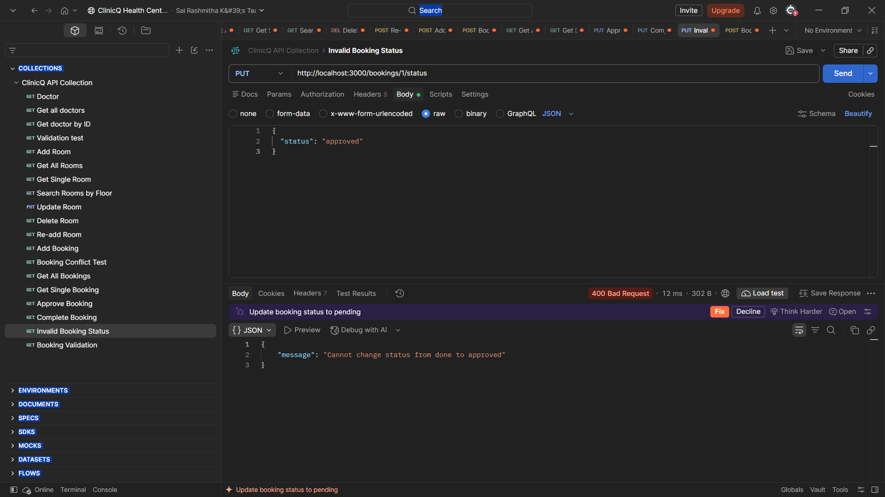

**8. Booking Input Validation**

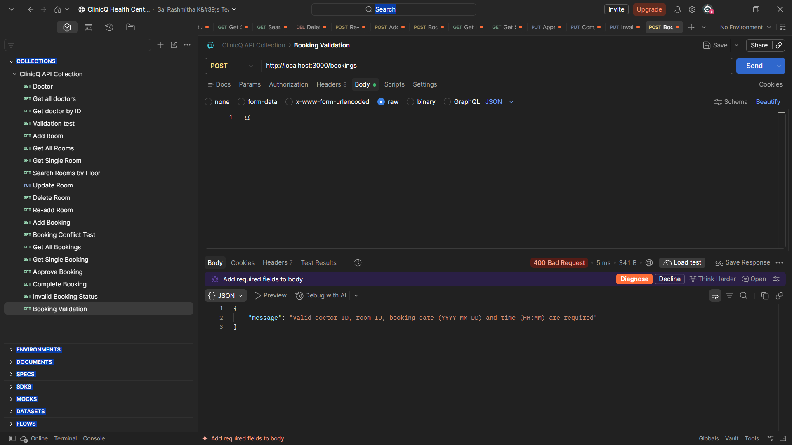

## 10. Conclusion

The ClinicQ Health Centre Consultation Room Booking System successfully demonstrates REST API development using Node.js, Express.js, and SQLite.

It provides functionality for managing doctors, consultation rooms, and bookings with proper input validation and error handling. The project also implements booking conflict prevention and booking status management.

The project helped our team understand backend development, database integration, REST API methods, and API testing using Postman.

## 11. Student Details

**Student Names:**

1. Sai Rashmitha
2. Gnanasahitya Reddy
3. Sai Vinitha
4. Mahesh
5. Tejo Sai

**Registration Numbers:**

1. 252U1R9056
2. 252U1R9021
3. 252U1R9054
4. 252U1R9034
5. 252U1R9002

**Section:** CSE (Gen-AI) 2A

**Course:** Backend Development Fundamentals

**Academic Year:** II Year, Term II

**Institution:** Aurora Deemed to be University

**Faculty:** Mr. Joel Prashanth D.

## 12. Team Members

The ClinicQ project was developed collaboratively by the following team members:

1. **Sai Rashmitha** – 252U1R9056
2. **Gnanasahitya Reddy** – 252U1R9021
3. **Sai Vinitha** – 252U1R9054
4. **Mahesh** – 252U1R9034
5. **Tejo Sai** – 252U1R9002

---

**GitHub Repository:** https://github.com/Rashmitha1525/ClinicQ-BDF-Assignment